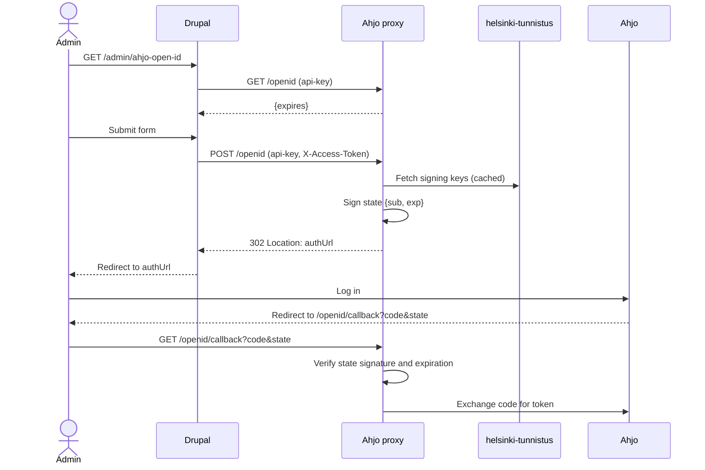

# Ahjo proxy v3

Standalone Symfony app that proxies allowlisted `GET` requests to the Ahjo API.
Paths and query strings are forwarded as-is, and Ahjo responses are returned as-is.

## Quick start

The `ahjo-proxy` service is defined in the project's `compose.override.yml`
and starts with `make up`. Drupal connects to it with the default local
credentials defined there.

```sh
make ahjo-proxy-up             # start (and composer install)
make ahjo-proxy-shell
make ahjo-proxy-refresh-token
make ahjo-proxy-stop
```

The proxy is available at https://ahjo-proxy-helsinki-paatokset.docker.so.

## Endpoints

- `GET /openid`: Ahjo auth token status (`{"expires": int|null}`). Requires
  `api-key` header.
- `POST /openid`: Starts the OpenID flow. Redirects to the Ahjo authorize
  endpoint. Requires `api-key` and `X-Access-Token` headers.
- `GET /openid/callback?code=...&state=...`: OpenID redirect URI. Ahjo redirects
  the admin's browser here. Exchanges the code for an Ahjo auth token. Authorized
  by the signed `state`, see [Ahjo auth token](#ahjo-auth-token).
- `GET /healthz`: health check.
- Endpoints proxied to Ahjo. Requires `api-key` header.
  - `GET /cases[/{id}]`
  - `GET /cases/{id}/handlings/{id}`
  - `GET /cases/{id}/records`
  - `GET /decisions[/{id}]`
  - `GET /resolutions`
  - `GET /initiatives`
  - `GET /records/{id}`
  - `GET /sectors`
  - `GET /functions`
  - `GET /meetings[/{id}]`
  - `GET /meetings/{id}/agendaitems/{id}`
  - `GET /motions`
  - `GET /organization`
  - `GET /organization/decisionmakingorganizations`
  - `GET /agents/positionoftrust[/{id}]`
  - `GET /councilgroups`
  - `GET /agents/decisionmakers`

  The allowlist matches the GET endpoints of the Ahjo REST API schema (v1.4.0).

`/openid` is meant to be called by Drupal when authenticating to Ahjo.
See [Ahjo auth token](#ahjo-auth-token).

## Authentication

- **`api-key`** allows calling the proxy.
- **`X-Access-Token`** required by `POST /openid` only.
  It is the Keycloak access token of the admin who is logged in to
  Drupal.

## Ahjo auth token

Refresh tokens are single-use, so the token is stored in `TOKEN_STORAGE_DIR`,
which must be a persistent volume.

The token is set up once by a person with Ahjo credentials. Browser part
of the flow runs in the Drupal admin UI (`/admin/ahjo-open-id`, `paatokset_ahjo_api` module):

1. The admin opens `/admin/ahjo-open-id` in Drupal. Drupal shows the token
   status from `GET /openid`.
2. The admin submits the form. Drupal calls `POST /openid` with its api key and
   the admin's access token.
3. The proxy verifies the admin and redirects to the Ahjo auth URL. The `state`
   in the URL is a ticket signed with `APP_SECRET` that names the admin and
   expires in 10 minutes. Drupal redirects the admin there, and the admin logs
   in to Ahjo.
4. Ahjo redirects the browser to the proxy `/openid/callback?code=...&state=...`
   (`AHJO_OPENID_REDIRECT_URI`).
5. The proxy verifies the signature and expiration of `state`, exchanges the
   code for a token with Ahjo, and stores it.
6. `bin/console ahjo-proxy:refresh-token` keeps the token fresh. Run it
   periodically (e.g. hourly OpenShift CronJob).

The callback request has no credentials, so the signed state is what authorizes
it. Only authorized admins get a valid state, so the proxy needs no session.



## Upstream proxy

Ahjo API is behind a firewall, so a locally running proxy cannot reach it.
Set `AHJO_UPSTREAM_PROXY_URL` to make the proxy forward requests to another
Ahjo proxy (e.g. the one running on OpenShift) instead of Ahjo. The upstream
proxy handles Ahjo authentication, so the OpenID flow is not needed locally.

```sh
# ahjo-proxy/.env.local
AHJO_PROXY_API_KEY=local-key
AHJO_UPSTREAM_PROXY_URL=https://<openshift ahjo proxy>
AHJO_UPSTREAM_PROXY_API_KEY=<openshift ahjo proxy api key>
```

Clients still call the local proxy with the local `AHJO_PROXY_API_KEY`:

```sh
curl -H 'api-key: local-key' 'https://ahjo-proxy-helsinki-paatokset.docker.so/cases?size=1'
```

## Configuration

See [.env](.env).

| Variable                      | Description                                                                                                                                               |
|-------------------------------|-----------------------------------------------------------------------------------------------------------------------------------------------------------|
| `AHJO_ENDPOINT`               | Ahjo API base URL.                                                                                                                                        |
| `AHJO_PROXY_API_KEY`          | The `api-key` that clients must send.                                                                                                                     |
| `AHJO_UPSTREAM_PROXY_URL`     | Optional upstream Ahjo proxy URL. See [Upstream proxy](#upstream-proxy).                                                                                  |
| `AHJO_UPSTREAM_PROXY_API_KEY` | The `api-key` sent to the upstream proxy.                                                                                                                 |
| `AHJO_OPENID_AUTH_URL`        | Ahjo OpenID authorize endpoint.                                                                                                                           |
| `AHJO_OPENID_TOKEN_URL`       | Ahjo OpenID token endpoint.                                                                                                                               |
| `AHJO_OPENID_CLIENT_ID`       | Ahjo OpenID client id.                                                                                                                                    |
| `AHJO_OPENID_SCOPE`           | Ahjo OpenID scopes.                                                                                                                                       |
| `AHJO_OPENID_SECRET`          | Ahjo OpenID client secret.                                                                                                                                |
| `APP_SECRET`                  | Signs the OpenID `state`. Required for the OpenID flow.                                                                                                   |
| `AHJO_OPENID_REDIRECT_URI`    | Public URL of the proxy `/openid/callback`. Must be registered as a redirect URI in Ahjo.                                                                 |
| `OIDC_ISSUER`                 | helsinki-tunnistus realm URL, e.g. `https://tunnistus.hel.fi/auth/realms/helsinki-tunnistus`.                                                             |
| `OIDC_ALLOWED_CLIENTS`        | Comma separated client ids, without spaces, the access token may be issued to, i.e. Drupal's tunnistamo client id.                                        |
| `OIDC_ALLOWED_AD_GROUPS`      | Comma separated AD groups, without spaces, that may manage the Ahjo auth token. The tunnistus client must include the `ad_groups` claim in access tokens. |
| `TOKEN_STORAGE_DIR`           | Persistent directory for the Ahjo auth token.                                                                                                             |

